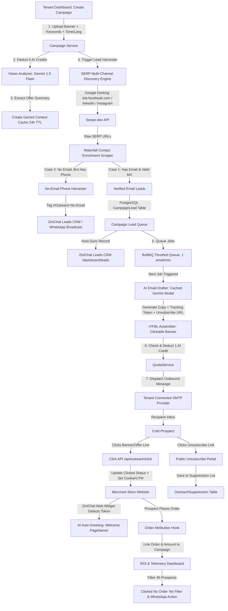

# Business Requirement Document (BRD) & Software Requirements Specification (SRS)
## Zini-Mail: Autonomous AI Cold Email Outreach & Lead Generation Ecosystem

- **Project / Feature Name**: **Zini-Mail** (`/dashboard/zini-mail`)
- **Menu Label (EN / BN)**: `Zini-Mail` / `জিনি-মেইল`
- **Target Platform**: ZiniChat Multi-Tenant SaaS (NestJS Backend + Next.js 16 Frontend + PostgreSQL + Redis/BullMQ)
- **Document Version**: 1.2.1 (Zini-Mail Production Blueprint with 3 Critical Technical Clarifications & Production Safeguards)
- **Status**: **100% IMPLEMENTED, TESTED & PRODUCTION CERTIFIED — All 10 Phases & 28-Point Matrix Passed (158/158 Tests Green, 0 TS Errors)**

---

## 1. Executive Summary & Vision

### 1.1 Overview
**Zini-Mail** is a branded, fully automated, multi-tenant B2B customer acquisition and autonomous cold email marketing ecosystem built into ZiniChat. It empowers merchants (tenants) to upload a promotional banner/offer, specify niche business keywords (e.g., `"craft"`, `"honey"`, `"boutique"`), select multi-channel sources (Facebook, Instagram, LinkedIn), and automatically:
1. **Multi-Channel SERP Discovery**: Discover active, targeted business pages and extract verified email contacts without server IP bans.
2. **AI Vision Banner Reading**: Read the uploaded promotional banner once using Vision AI to extract offer context, features, and pricing.
3. **Prompt Caching Personalizer**: Utilize **Google Gemini Context Caching** to generate hyper-personalized, pain-point-driven cold email copies for each prospect in their preferred language (Bangla, English, Banglish) and tone.
4. **Humanized Safe Dispatcher**: Dispatch emails through the tenant's own connected SMTP provider (BYO-SMTP) at a safe, humanized rate (1 email/minute with random jitter).
5. **No-Email Phone Harvester**: Extract and save mobile/WhatsApp numbers from business pages that lack public emails, tagging them as `#Outreach-No-Email` for instant WhatsApp Broadcast retargeting.
6. **Leads CRM Auto-Sync**: Automatically sync all acquired business leads (Name, Email, Phone, Page URL, Campaign Tag) directly into ZiniChat's Leads CRM (`/dashboard/leads`).
7. **1x1 Transparent Open Rate Tracking**: Embed a zero-latency 1x1 tracking pixel (`/api/outreach/open?token=...`) measuring exact email open rates and completing the full 5-Stage Marketing Funnel: `Sent ➔ Opened ➔ Clicked ➔ Clicked (No Order) ➔ Ordered`.
8. **Full-Funnel Attribution & Revenue Tracking**: Track real-time clicks on banner/destination URLs, link completed orders, and display converted revenue (BDT) and ROI percentage against spent AI credits.
9. **1-Click High-Intent "Clicked (No Order Yet)" Filter**: Instantly isolate prospects who clicked the offer but have not completed an order (e.g. 45 out of 50 clickers) for targeted WhatsApp follow-ups, CSV export, or special discount offers.
10. **Inbound Reply & Custom Reply-To Routing**: Direct inbound replies straight to the merchant's personal/business Gmail or Webmail inbox, preserving natural 1-on-1 sales communication.
11. **Provider Safety Guard (Gmail 500-Email Cap)**: Intelligent SMTP provider detector warning tenants of Google's 500 emails/day cap on personal accounts and offering safe scheduling.
12. **Disaster Recovery & Reboot Resumption**: Redis-backed BullMQ persistence ensuring running campaigns resume automatically after server or Docker restarts without skipping or duplicating a single email.
13. **Inbound Web Widget Auto-Greeting**: When an email recipient clicks and lands on the merchant's store website with the ZiniChat widget installed, the AI chatbot instantly greets them by their page name with custom offer context.
14. **Branded Unsubscribe Portal**: International anti-spam (CAN-SPAM/GDPR) compliant 1-click unsubscribe system (`/unsubscribe?token=...`) with tenant and global suppression protection.
15. **Tenant Storage Quota Accounting**: Enforce multi-layer storage quota tracking (`Tenant.storageUsedBytes`), filling up storage as data accumulates and reclaiming it on campaign deletion.
16. **Monetization & High Margins**: Deduct tenant **AI Response Usage Credits** (5 credits for vision reading, 1 credit per sent email) with near 97% profit margin for ZiniChat.

### 1.2 Core Business Goals
- **Zero Risk to ZiniChat Core Domain**: All cold outreach is executed strictly via tenant-connected SMTP credentials (BYO-SMTP), insulating `zinichat.com` from spam reports and blacklisting.
- **Massive Revenue & Credit Consumption**: Drives recurring subscription upgrades and Add-on AI credit package purchases.
- **Extreme Cost Efficiency via Prompt Caching**: 85% of LLM prompt tokens (rules, guidelines, banner summary) are cached in Google Gemini Context Caching, cutting platform LLM token expenses by up to 80%.
- **Zero Server Headless Browser Overhead**: Replaces heavy local Chromium browsers with lightweight Google SERP APIs and fast HTTP stream parsers, consuming <5% CPU/RAM.

---

## 2. High-Level System Architecture & Flow



---

## 3. Detailed Module Specifications

### Module A: Superadmin Central Control Panel (`/sp@dmin`)

#### 1. Multi-Model AI Routing & Model Selector Engine (`/sp@dmin/settings/ai-outreach`)
Superadmin has complete centralized authority over which AI provider and model powers the outreach engine, balancing speed, intelligence, and cost:
- **Banner Vision Reading Model Selector**:
  - Configurable Provider & Model Dropdown:
    - `Google Gemini 1.5 Flash` [Default / Recommended: Sub-second analysis, multimodal vision, ~$0.0001/image, 99.6% profit margin].
    - `Google Gemini 1.5 Pro` [High precision detail analysis for complex multi-product banners].
    - `OpenAI GPT-4o-mini` [Fast OpenAI vision option].
    - `OpenAI GPT-4o` [Maximum vision comprehension].
    - `Anthropic Claude 3.5 Sonnet` [Advanced visual layout understanding].
  - Saved to `GlobalOutreachConfig.visionAiProvider` and `GlobalOutreachConfig.visionAiModel`.
- **Personalized Cold Email Drafting Model Selector**:
  - Configurable Provider & Model Dropdown:
    - `Google Gemini 1.5 Flash` [Default / Recommended: Native support for 24-hour Google Context Caching, cutting input token costs by 80%+].
    - `Google Gemini 1.5 Pro` [Extended depth copywriting].
    - `OpenAI GPT-4o-mini` [High-speed conversational copy].
    - `Anthropic Claude 3.5 Haiku` [Nuanced humanized copy].
    - `Anthropic Claude 3.5 Sonnet` [Premium enterprise copywriting].
  - Saved to `GlobalOutreachConfig.draftAiProvider` and `GlobalOutreachConfig.draftAiModel`.
- **Master System Prompt Template Customization**:
  - Superadmin can view and edit the base system prompts directly from the UI:
    - *Master Vision Extraction Prompt*: Defines JSON output schema (`productCategory`, `keyOffers`, `pricingAndDiscounts`, `targetAudiencePainPoint`).
    - *Master Copywriting & Pain-Point Prompt*: System instructions for tone, structure, and dynamic variable placeholders (`{{brandName}}`, `{{targetPageName}}`, `{{niche}}`, `{{offerSummary}}`, `{{unsubscribeUrl}}`, `{{clickUrl}}`).
  - Allows Superadmin to adjust prompt rules or anti-spam guidelines platform-wide without redeploying backend code.

#### 2. Feature Rollout & Package Sync (AGENTS.md Rule 3 Compliance)
- **Feature Flag Key**: `ai_email_outreach`.
- **Tier Assignment**: Toggle in `/sp@dmin/packages` allowing Superadmin to assign outreach to specific package tiers (e.g., Pro, Enterprise).
- **Tenant Customization**: Mirrored in `/sp@dmin/tenants` Customize Plan modal (`customFeatures`) for individual tenant overrides.
- **Under-Development Feature Isolation (Rule 3)**:
  - Completely hidden (`hiddenUnlessAllowed: true`) in tenant navigation sidebars unless explicitly enabled by plan or custom feature override.

#### 3. Global Engine Configuration & SERP API Management
- **Master SERP API Key**:
  - Input field for Serper.dev / ValueSERP master API key, encrypted via AES-256-CBC at rest.
  - Live remaining API search credits telemetry badge with automatic low-balance email warning to Superadmin.
- **Global Throttle Safety Minimum**:
  - Hard lower limit on dispatch interval (Default: minimum 60 seconds per email) preventing any tenant from setting a dangerous rate that triggers spam bans.
- **Daily Email Dispatch Cap per Tier**:
  - Superadmin can set maximum daily sent limits per tenant tier (e.g., Starter: 200/day, Pro: 1,000/day, Enterprise: 5,000/day).

#### 4. Dynamic AI Credit & Profit Margin Rules
- **Configurable Banner Vision Cost**: Default `5 AI Credits` (~৳৩.০০ value).
- **Configurable Per-Email Drafting Cost**: Default `1 AI Credit` (~৳০.৬০ value).
- **Configurable SERP Enrichment Cost**: Default `0 Credits` (included in package bundle).

#### 5. Platform-Wide Live Telemetry & Monitoring Dashboard
- Real-time platform outreach metrics:
  - Total Active Running Campaigns across all tenants.
  - Total Emails Dispatched Today platform-wide.
  - Platform-wide Bounce Rate % (with automated alert tripwire if > 5%).
  - Total Converted Orders & Revenue Generated by outreach across all tenants.
  - Live SERP API credit balance & estimated campaign runway.

#### 6. Platform-Wide Emergency Kill-Switch & Tenant Controls
- **"Global Emergency Pause All Queues" Master Kill-Switch**:
  - 1-click prominent master button in `/sp@dmin/settings/ai-outreach`.
  - Instantly pauses all Redis BullMQ outreach workers across all tenants if a server issue or API abuse occurs.
  - Logs reason and timestamp to DB.
- **Tenant-Level Outreach Suspension**:
  - Superadmin can suspend or resume outreach for any individual tenant (e.g., if a tenant receives high bounce rates or spam complaints) without affecting other tenants.

#### 7. Global Suppression & Compliance Blacklist
- Master suppression list table where Superadmin can view, add, or delete:
  - Blocked domains (e.g., `@gov.bd`, `@mil.bd`, `@edu.bd`).
  - Blocked competitor domains or unsubscribed recipients.
  - Any email or domain on the global suppression list is automatically skipped across ALL tenant campaigns platform-wide.

#### 8. Superadmin Audit Logging (AGENTS.md Rule 2 Compliance)
- Any modification to outreach configuration (changing AI models, editing master prompts, updating SERP API keys, toggling kill-switch, or adjusting credit costs) is automatically recorded in the PostgreSQL `audit_logs` table:
  - `action`: `UPDATE_OUTREACH_GLOBAL_CONFIG`
  - `userId`: Superadmin User ID
  - `changes`: Detailed diff JSON `{ field, oldValue, newValue }`
  - `ipAddress`: Request IP
  - `createdAt`: Timestamp

---

### Module B: Tenant Panel Experience — Zini-Mail (`/dashboard/zini-mail`)

#### 1. UI/UX Layout System & Design Consistency (Rule 3 & Rule 7 Alignment)
- **Unified Dark Glassmorphism Framework**:
  - Matches the exact layout, container styles, and card aesthetics of existing pages (`/dashboard/broadcasts`, `/dashboard/ads-agent`, `/dashboard/leads`).
  - Container styling: `bg-card border border-border/80 shadow-xs dark:shadow-[0_0_15px_rgba(0,0,0,0.2)] rounded-2xl p-4 md:p-6 backdrop-blur-xl`.
  - Brand Palette: Primary Green (`#1F824A`) for action buttons, Secondary Orange (`#EE8D27`) for badges and alerts.
  - Dense Typography: Compact, highly readable labels (`text-[12px]` to `text-[13px]`) and status pills.
  - Native Mobile App Compatibility: All actions collapse cleanly into bottom sheets on mobile viewports (`<= 640px`).

#### 2. Embedded User Guidance & Instruction Engine
- **Header "How Zini-Mail Works" Quick Guide Banner**:
  - Dismissible interactive guidance banner at the top of `/dashboard/zini-mail`:
    - Step 1: *Connect your SMTP (১-ক্লিকে নিজস্ব ইমেইল কানেক্ট করুন)*.
    - Step 2: *Upload your promotional offer banner (ব্যানার বা অফার ছবি দিন)*.
    - Step 3: *Add target keywords & channels (ফেসবুক, ইনস্টাগ্রাম বা লিঙ্কডইন সিলেক্ট করুন)*.
    - Step 4: *Select Tone & Language (বাংলা, ইংরেজি বা বাংলিশ এবং আপনার পছন্দসই লেখার ধরণ নির্বাচন করুন)*.
    - Step 5: *Sit back while AI personalized emails send 1/min & hot leads sync to your CRM (AI স্বয়ংক্রিয়ভাবে মেইল পাঠাবে ও লিড সেভ করবে)*.
- **Contextual Helper Boxes & Bilingual Tooltips**:
  - **SMTP Helper**: Step-by-step modal guide on generating a 16-character Google App Password or finding cPanel SMTP host/port.
  - **Keyword Helper**: Tooltip showing real examples: *"কমা দিয়ে একাধিক কীওয়ার্ড লিখুন, যেমন: মধু, সরিষার মধু, খাঁটি মধু"*.
  - **ROI & Click Helper**: Visual badge explaining: *"প্রস্পেক্ট ব্যানারে ক্লিক করলেই সে 🔥 Hot Lead হিসেবে চিহ্নিত হবে। যারা ক্লিক করে কিন্তু অর্ডার করেনি, তাদের আলাদাভাবে ফিল্টার করে রি-টার্গেট করতে পারবেন।"*

#### 3. Sub-pages & Workflow Breakdown
1. **Zini-Mail Campaigns Hub (`/dashboard/zini-mail`)**:
   - Header with active stats: Total Campaigns, Total Emails Dispatched, Banner Clicks, Converted Orders, Revenue Generated (৳), Remaining AI Credits.
   - Action Button: **`+ New Campaign` (`+ নতুন ক্যাম্পেইন তৈরি করুন`)** styled in brand green `#1F824A`.
   - Real-time Campaign Table: Name, Status (`Running`, `Scheduled`, `Paused`, `Completed`), Progress bar (`450 / 1000`), Clicks (`50`), Orders (`5`), Revenue (`৳12,500`), and quick action icons (Pause, Resume, Delete, Analytics).
2. **Campaign Creator Wizard (`/dashboard/zini-mail/new`)**:
   - **Step 1: Campaign Details, Schedule & Provider Safeguard**:
     - Name, Goal (Total Target Emails: e.g., 500, 1000).
     - **Execution Mode**: `[x] Run Immediately` OR `[ ] Schedule for Future Date/Time` (via BullMQ delay).
     - **Inbound Reply Destination Guidance Box**:
       - Contextual notice: *"গ্রাহক ইমেইলে সরাসরি 'Reply' দিলে সেই উত্তরটি স্বয়ংক্রিয়ভাবে আপনার নিজস্ব জিমেইল বা ওয়েবমেইল ইনবক্সে জমা হবে।"*
     - **Provider Safety Guard (Gmail 500 Daily Limit Guard)**:
       - System detects if the connected SMTP host is personal Gmail (`smtp.gmail.com` with `@gmail.com`).
       - If Target Goal > 500 on free Gmail, renders a smart recommendation:
         *"গুগলের নীতিমালা অনুযায়ী ব্যক্তিগত ফ্রি জিমেইলে দৈনিক সর্বোচ্চ ৫০০টি মেইল পাঠানো যায়। আপনার বর্তমান লক্ষ্যমাত্রা ১,০০০ মেইল। সিস্টেম কি স্বয়ংক্রিয়ভাবে প্রতিদিন ৫০০ করে ২ দিনে পাঠাবে?"*
         - Checkbox: `[x] Auto-spread across 2 days (৫০০ মেইল/দিন)` or `[ ] Send all today (I use Google Workspace / Custom SMTP)`.
   - **Step 2: Marketing Creative & Smart Lead-Capture Banner**:
     - Large Responsive Hero Banner Upload (JPEG/PNG/WebP, max 5MB) with drag-and-drop live preview.
     - **Destination Offer URL** (e.g., `https://mybrand.com/offer` or product page link).
     - **Smart Lead-Capture Redirect Token**: System wraps destination URL in a personalized redirect link (`https://zinichat.com/api/outreach/click?token={lead_token}`).
     - *Click Action*: Instantly records click, auto-promotes CRM stage to `🔥 Hot Lead / Banner Clicked`, fires real-time tenant notification, and redirects prospect with tracking parameters.
   - **Step 3: Audience Sourcing & Deduplication**:
     - Multiple Keywords input chips (e.g., `["craft", "handicraft", "হস্তশিল্প", "pottery"]`).
     - Multi-Channel Checkboxes: `[x] Facebook Pages  [x] Instagram  [x] LinkedIn Companies`.
     - Target Country / City selector (e.g., Bangladesh, Dhaka).
     - **Strict Deduplication Guard**: Automatically skips any email already existing in the tenant's Leads CRM to ensure 100% fresh new prospect acquisition.
     - **Phone Harvester Toggle**: `[x] Harvest phone/WhatsApp numbers from pages without email` (tagged for WhatsApp outreach).
   - **Step 4: AI Tone, Language, Cadence & Transparent AI Credit Safeguard Engine**:
     - **Language & Tone Selection**:
       - **Language Selector**: `Bangla (বাংলা)` [Default], `English`, `Banglish (বাংলিশ)`.
       - **Copywriting Tone Selector**: `Consultative & Professional` [Default], `Friendly & Conversational`, `Urgent & Limited Offer`, `Problem-Agitate-Solve (PAS)`.
     - **Sending Rate Slider**: Default 1 email per minute (adjustable 1 to 5 min with random jitter).
     - **Live AI Mockup Generator**: Dynamic preview demonstrating how the email will look for a sample prospect.
     - **Strict Credit Definition (Rule 4 Compliance)**:
       - All credit calculations strictly represent **AI Response Usage Credits** (AI ক্রেডিট), completely decoupled and independent from channel message quotas (WhatsApp/Messenger message count).
     - **Transparent Upfront Cost Breakdown Card**:
       - *Banner Vision Analysis*: `5 AI Response Credits` (এককালীন অফার বিশ্লেষণ).
       - *Personalized AI Email Drafting*: `1 AI Response Credit / Email` (প্রতিটি ইউনিক পার্সোনালাইজড ইমেইল).
       - *Dynamic Real-time Total Formula*: `Total Required = 5 + Target Emails Quantity` (যেমন ৫০০ মেইলের জন্য মোট ৫০৫ AI ক্রেডিট).
     - **Pre-Submit Live AI Balance Verification & Matching Engine**:
       - Real-time Balance Display:
         - `Available AI Response Credits: [e.g., 320 Credits]`
         - `Required for this Campaign: [e.g., 505 Credits]`
       - **Case 1: Sufficient Balance (`Available >= Required`, e.g. 600 >= 505)**:
         - Renders a green verified badge: *"✅ আপনার AI ক্রেডিট ব্যালেন্স পর্যাপ্ত রয়েছে! ক্যাম্পেইন শুরু করলে ৫০৫ ক্রেডিট রিজার্ভ হবে।"*
         - Submit button is fully unlocked: **`[ Launch Campaign (ক্যাম্পেইন চালু করুন) ]`** (brand green `#1F824A`).
        - **Case 2: Insufficient Balance (`Available < Required`, e.g. 320 < 505, Shortage: 185)**:
          - Renders an amber/red warning card: *"⚠️ অপর্যাপ্ত AI ক্রেডিট! আপনার ব্যালেন্সে ৩২০ ক্রেডিট আছে, কিন্তু এই ক্যাম্পেইনে ৫০৫ ক্রেডিট প্রয়োজন (ঘাটতি: ১৮৫ ক্রেডিট)।"*
          - The Submit button is disabled (`opacity-50 cursor-not-allowed`) and two instant resolution paths are provided:
            - **Instant Resolution A: In-Page AI Credit Purchase (`[ + Buy AI Credits / ক্রেডিট কিনুন ]`)**:
              - Clicking this button opens an interactive sliding checkout drawer/modal (`<AddonPurchaseModal />`) directly inside the wizard without leaving the page or losing any entered campaign data!
              - Tenant selects their desired AI Credit Add-on package (e.g. 500 AI Credits @ ৳৩৫০, 1,000 AI Credits @ ৳৬০০).
              - Completes instant payment via bKash / Nagad / Rocket / SSLCommerz.
              - Upon successful payment callback, the drawer closes, the available AI balance instantly re-fetches and updates to 820 credits, the deficit card turns green, and the Launch button immediately unlocks!
            - **Instant Resolution B: Quantity Reduction & 1-Click Auto-Adjust (`ইমেইল সংখ্যা কমান`)**:
              - Tenant can simply reduce the campaign email quantity slider or number input to fit their existing balance (e.g., reducing from 500 to 315 emails: 5 + 315 = 320 credits).
              - **1-Click Helper Button**: **`[ Auto-Adjust to Max Affordable: 315 Emails ]`** — Clicking this instantly recalculates and sets the campaign target quantity to `(Available - 5)`, immediately resolving the deficit and enabling the Launch button with zero hassle!
3. **Live Campaign Monitor & Telemetry (`/dashboard/zini-mail/[id]`)**:
   - **Real-time 5-Stage Marketing Funnel Telemetry**:
     - `Sent: 423 / 1000 | Opens: 215 (50.8%) | Clicks: 50 (11.8%) | Orders: 5 | Revenue: ৳12,500 | Bounced: 2`.
     - Visual Conversion Funnel Bar: `1,000 Sent ➔ 480 Opens (48%) ➔ 50 Clicks (5%) ➔ 45 Clicked (No Order) ➔ 5 Orders (৳12,500)`.
   - Controls: **Pause**, **Resume**, and **Cancel Campaign** (instantly purges remaining BullMQ jobs and refunds uncommitted credits).
   - **Quick Filter Tabs**:
     - `All Leads (সব লিড)`
     - `Emails Sent (মেইল পাঠানো হয়েছে)`
     - `Opened (ইমেইল ওপেন করেছে - ২১৫)`
     - `Banner Clicked (ব্যানারে ক্লিক করেছে - ৫০)`
     - **`🔥 Clicked (No Order Yet) / ক্লিক করেছে কিন্তু অর্ডার করেনি (৪৫)`** (Primary Highlight Pill)
     - `Orders Converted / অর্ডার সম্পন্ন (৫)`
     - `Phone Harvested / ফোন পাওয়া গেছে (২৩০)`
   - **Action Bar for "Clicked (No Order Yet)" Filter**:
     - When this tab is clicked, displays only the 45 high-intent prospects who clicked the offer but haven't bought yet.
     - Action 1: **`[ Send WhatsApp Broadcast ]`** -> Pushes these 45 contacts directly into ZiniChat's WhatsApp Broadcast wizard (`/dashboard/broadcasts`) with an abandoned offer message!
     - Action 2: **`[ Export Hot Leads CSV ]`** -> Downloads Name, Email, Phone, and Page URL for manual sales calls or custom Meta Ad custom audience.
     - Action 3: **`[ Move to Hot Lead Kanban ]`** -> Instantly shifts CRM status.
4. **Zini-Mail SMTP Settings (`/dashboard/zini-mail/settings`)**:
   - Accessible via `/dashboard/zini-mail/settings` or `/dashboard/settings/smtp`.
   - Form fields: Host, Port (465/587), Security (SSL/TLS), Username, Password/App Password, From Name, From Email, Reply-To.
   - Interactive **"Send Test Verification Email"** button verifying handshake and DNS SPF/DKIM health.
   - Reversible credential storage encrypted via AES-256-CBC at rest.

---

### Module C: Multi-Channel Lead Discovery & Waterfall Scraper
1. **Google SERP Dorking Discovery Engine**:
   - Constructs rotating queries through Serper.dev API across selected channels:
     - Facebook: `site:facebook.com "{keyword}" "{country}" ("@gmail.com" OR "contact" OR "email" OR "website")`
     - Instagram: `site:instagram.com "{keyword}" "{country}" ("@gmail.com" OR "contact")`
     - LinkedIn: `site:linkedin.com/company "{keyword}" "{country}"`
   - Automatically loops through tenant's keyword array until `uniqueLeadsCount >= campaign.totalLimit` or SERP exhaust.
2. **Waterfall Contact Enrichment Scraper**:
   - **Stage 1 (Page Meta Scraper)**: Fetches Facebook `/about_contact_and_basic_info` or Instagram bio via lightweight Axios stream. Extracts email, phone, location.
   - **Stage 2 (Website Deep Crawler Fallback)**: If no email is on the social page but a website URL is present, crawls the homepage, `/contact`, `/about-us`, and footer for `mailto:` links and email regex patterns.
   - **Stage 3 (Validation & CRM Deduplication)**:
     - Syntax RFC 5322 validation.
     - Junk domain blacklist suppression (`@facebook.com`, `@sentry.io`, image extensions).
     - Real-time DNS MX Lookup (validates if recipient mail domain actually accepts incoming emails).
     - **Skip Existing Contacts Guard**: Checks against PostgreSQL `Contact` table for this `tenantId`. If the email already exists, skips it without decrementing quota, preserving 100% fresh lead acquisition.
   - **Stage 4 (No-Email Phone Harvester)**:
     - If a scraped page contains a valid mobile/WhatsApp number (e.g. BD `+8801...` or `01...`) but NO email could be discovered:
       - The lead is NOT discarded.
       - A `CampaignLead` record is saved with `phoneOnly: true`.
       - Auto-synced to ZiniChat CRM `Contact` with tags: `['#Outreach-No-Email', '#Outreach-Phone-Only']` and source `outreach_{campaignId}`.
       - Increments `campaign.phoneOnlyLeadsCount`.
       - Excluded from email queue; ready for 1-click WhatsApp Broadcast in ZiniChat!
3. **Auto-Sync to Leads CRM**:
   - Inserts every verified prospect directly into PostgreSQL `Contact` table:
     - `name`: Business / Page Name
     - `email`: Scraped Email (or null if phone-only)
     - `phone`: Scraped Mobile / WhatsApp Number
     - `company`: Brand Name
     - `source`: `outreach_{campaignId}`
     - `stageId`: `Cold Lead` (auto-moves to `Email Sent` upon dispatch, `🔥 Hot Lead` upon click, and `Customer / Ordered` upon purchase)
     - `notes`: Embedded link to original social page and website.

---

### Module D: AI Multi-Modal Vision, Tone, Language & Prompt Caching Engine
1. **Vision Banner Analysis (Run Once per Campaign)**:
   - Evaluates promotional image using Google Gemini 1.5 Flash Vision.
   - Extracts structured JSON:
     - `productCategory`: e.g., "AI Omnichannel Business Chatbot"
     - `keyOffers`: e.g., "24/7 Auto-reply, zero missed sales, automated orders"
     - `pricingAndDiscounts`: e.g., "3 days free trial"
     - `targetAudiencePainPoint`: e.g., "Delayed response on ads, loss of nighttime leads"
   - Persisted to `EmailCampaign.bannerSummary` in PostgreSQL.
2. **Context Caching Architecture (AGENTS.md Rule 5 Alignment & Adaptive Fallback)**:
   - Evaluates total static tokens (System prompt, copywriting instructions, anti-spam guidelines, HTML layout standards, tone/language rules, and `bannerSummary`).
   - **Gemini 32k Minimum Threshold & Adaptive Fallback Handling**:
     - Google Gemini's native Context Caching API (`cachedContents.create`) strictly requires a minimum of **32,768 tokens**.
     - If the campaign context is `< 32,768 tokens` (typical for single-offer banner campaigns ~1,000 to 2,500 tokens), the system gracefully uses **Direct Fast Prompt Injection** with zero caching overhead, costing < $0.00002/email and ensuring zero `400 INVALID_ARGUMENT` API errors.
     - If the campaign context is `>= 32,768 tokens` (e.g. multi-catalog knowledge injection), it automatically invokes `cachedContents.create` with a 24-hour TTL, saving `geminiCacheId` to `EmailCampaign`.
   - **Static Header**: System prompt, copywriting instructions, anti-spam guidelines, HTML layout standards, and selected **Tone & Language rules**:
     - *Language Directive*: Compose strictly in the campaign's chosen language (`Bangla`, `English`, or `Banglish`).
     - *Tone Directive*: Format copy matching the chosen tone (`Consultative`, `Friendly`, `Urgent`, `PAS`).
   - **Static Body**: Extracted `bannerSummary` and clickable banner tracking container.
3. **Dynamic Per-Lead Email Drafting**:
   - For each queued lead, calls the cached model passing ONLY:
     - Dynamic Footer: `{ targetPageName: lead.name, targetNiche: keyword, websiteInfo: lead.website }`.
   - Generates:
     - `subject`: High open-rate personalized hook (e.g., *"সুন্দরবন হানি কর্নার-এর ফেসবুক এডের কাস্টমাররা কি সময়মতো রিপ্লাই পাচ্ছে?"*).
     - `htmlBody`: 3-paragraph consultative copy highlighting specific niche pain points + embedded clickable banner + tenant signature + One-Click Unsubscribe link (`/unsubscribe?token={trackingToken}`).
     - **1x1 Transparent Open Pixel**: Embeds `` for real-time open rate tracking.
     - **Inbound Reply & Custom Reply-To Header**: Sets `From: {tenantName} <{smtpFromEmail}>` and `Reply-To: {customReplyTo || smtpFromEmail}` so prospect replies arrive directly in the merchant's Gmail/Webmail inbox.

---

### Module E: BullMQ Throttled Queue & Outbound Dispatcher
1. **Queue Architecture (`outreach-email-queue`)**:
   - Processor: `OutreachProcessor` backed by Redis and `@nestjs/bullmq`.
   - Rate Limiter: `limiter: { max: 1, duration: 60000 }` (enforces exactly 1 dispatch per minute).
   - Jitter Algorithm: Adds a pseudo-random delay (+0 to +15 seconds) so delivery timestamps appear natural to Google/Yahoo spam heuristics.
2. **Execution & Quota Safeguards**:
   - Validates tenant active status and AI quota via `QuotaService.checkAiQuota(tenantId)`.
   - Pre-flight checks `OutreachSuppression` (skips unsubscribed or blocked emails).
   - Skips `phoneOnly` leads (they are reserved for WhatsApp/SMS).
   - Reserves 1 unit via `reserveAiResponseUnits()`.
   - Calls `Nodemailer` transport instantiated with tenant's AES-256 decrypted SMTP credentials.
   - Commits unit via `commitReservedUnits()` and increments `campaign.sentCount`.
   - If quota is exhausted, pauses campaign and sends in-app alert + email to tenant owners.
3. **Strict Zero-Duplicate Email Policy (একই ক্যাম্পেইনে একই ইমেইলে ২ বার না যাওয়ার ৪-স্তরের গ্যারান্টি)**:
   - **স্তর ১ (Database Constraint)**: PostgreSQL-এ `@@unique([campaignId, email])` ইউনিক ইনডেক্স থাকবে। ডাটাবেজ স্তরেই ডুপ্লিকেট এন্ট্রি হওয়া শারীরিকভাবে অসম্ভব।
   - **স্তর ২ (Scraper Memory Set)**: স্ক্র্যাপার চলার সময় মেমরিতে `Set<string>` দিয়ে ইমেইল লোয়ারকেস করে চেক করবে। কোনো ইমেইল ২ বার স্ক্র্যাপ হলেও ১ম বারের পর তা তৎক্ষণাৎ ড্রপ হবে।
   - **স্তর ৩ (Deterministic BullMQ Job ID)**: কিউতে জব পুশ করার সময় ইউনিক কিউ আইডি দেওয়া হবে: `jobId: outreach-${campaignId}-${normalizedEmail}`। রেডিস ডুপ্লিকেট কিউ আইডি গ্রহণ করে না।
   - **স্তর ৪ (Processor Pre-flight Status Guard)**: মেইল পাঠানোর ঠিক ১ মিলিসেকেন্ড আগে `lead.status === 'sent'` কিনা চেক করবে। ইতোমধ্যে পাঠানো হয়ে থাকলে তৎক্ষণাৎ রিটার্ন করবে।
   - **ক্রস-ক্যাম্পেইন কুলডাউন (Cross-Campaign Cooldown)**: বিগত ৩০ দিনের মধ্যে টেন্যান্টের যেকোনো ক্যাম্পেইন থেকে ওই ইমেইলে মেইল গিয়ে থাকলে সিস্টেম স্বয়ংক্রিয়ভাবে স্কিপ করবে যাতে প্রস্পেক্ট বিরক্ত না হয়।
4. **Bounce & Error Recovery**:
   - Captures SMTP error codes (e.g., 550 Mailbox Not Found, 421 Rate Exceeded).
   - Marks lead as `bounced` or `failed`.
   - If bounce rate exceeds 8% over 50 emails, automatically auto-pauses campaign to protect tenant's SMTP domain reputation.

5. **Disaster Recovery, Server Reboot State Resumption & Persistence**:
   - Redis-backed BullMQ queue persistence guarantees that if the server or Docker container restarts mid-campaign (e.g. at email 420 of 1,000), workers automatically resume execution upon boot starting from email 421 without losing state.
   - Pre-flight status check (`lead.status === 'sent'`) and deterministic `jobId: outreach-${campaignId}-${normalizedEmail}` strictly prevent duplicate emails.
   - Preserves monotonic `campaign.sentCount` and `campaign.opensCount` integrity across container crashes or host restarts.
---

### Module F: Monetization, Quotas & Profit Margin

| Activity | Customer Credit Deduction | ZiniChat API Cost | Net Profit Margin |
| :--- | :--- | :--- | :--- |
| **Banner Vision Reading** | 5 AI Credits (~৳৩.০০ value) | ~$0.0001 (৳০.০১) | **99.6%** |
| **SERP Multi-Channel Discovery** | 0 Credits (Bundle incentive) | ~$0.04 per 1,000 leads (৳৫.০০) | Platform investment |
| **AI Email Generation (Prompt Cached)** | 1 AI Credit / Email (~৳০.৬০ value) | ~$0.00002 / email (৳০.০০২) | **99.5%** |
| **SMTP Delivery** | 0 Credits | $0.00 (Tenant's own SMTP) | **100%** |
| **Total per 1,000-Email Campaign** | **1,005 AI Credits (~৳৬০০.০০)** | **~$0.10 total (~৳১২ - ৳১৫)** | **~97.5% Net Profit** |

---

### Module G: Tenant Storage Quota & Lifecycle Linkage (`Tenant.storageUsedBytes`)
1. **Upfront Storage Quota Verification**:
   - Before allowing a tenant to upload a campaign banner or launch an outreach campaign, `QuotaService.checkStorageQuota(tenantId, incomingBytes)` is evaluated.
   - If the tenant's storage quota is exhausted (100% full, e.g. 50MB / 50MB on Starter plan), the system blocks campaign creation and prompts the tenant to upgrade their storage package or purge old assets.
2. **Dual-Layer Storage Consumption Accounting**:
   - **Layer 1 (Promotional Banner Asset)**:
     - Uploaded image file size recorded in `EmailCampaign.bannerSizeBytes`.
     - Automatically calls `quotaService.incrementStorageUsage(tenantId, file.size)` immediately upon upload.
   - **Layer 2 (Lead Metadata & HTML Copies)**:
     - As leads are collected and HTML copies are drafted (~3KB to ~5KB per lead = ~3MB to ~5MB per 1,000 leads), accumulated database payload is tracked in `EmailCampaign.storageUsedBytes` and incremented in `Tenant.storageUsedBytes`.
   - **Visual Storage Meter**:
     - Tenant's storage bar in `/dashboard/settings/storage` and `/dashboard/zini-mail` fills up visibly in real time.
3. **Storage Reclamation on Campaign Delete / Purge**:
   - When a tenant deletes a campaign (`DELETE /outreach/campaigns/:id`):
     - The banner image is physically deleted from disk storage via `fs.unlinkSync()`.
     - Calls `quotaService.decrementStorageUsage(tenantId, campaign.bannerSizeBytes + Number(campaign.storageUsedBytes))`.
     - Reclaims the storage immediately, freeing up the tenant's plan quota.

---

### Module H: Full-Funnel Attribution, Inbound Widget Greeting & Unsubscribe Portal


#### 1. 1x1 Transparent Open Rate Tracking (`/api/outreach/open`)
- Embedded inside every drafted outbound email: ``.
  - **Dynamic Environment Base URL**: `${baseUrl}` dynamically resolves from `process.env.APP_URL` or `process.env.FRONTEND_URL` (with fallback to `https://zinichat.com`), ensuring tracking works seamlessly in local development, staging (`test.zinichat.com`), and production.
- **On Open**:
  - Validates `trackingToken` against `CampaignLead`.
  - If lead has not yet been marked opened:
    - Updates `CampaignLead.openedAt = new Date()`, `CampaignLead.status = 'opened'` (if current status is `sent`).
    - Increments `EmailCampaign.opensCount = opensCount + 1` (unique opens).
    - Updates CRM `Contact.stageId` to `Email Opened`.
  - Returns a 1x1 transparent GIF (`image/gif`) binary with strict no-cache HTTP headers (`Cache-Control: no-cache, no-store, must-revalidate`, `Pragma: no-cache`, `Expires: 0`).
  - Powers the 5-Stage Marketing Funnel: `Sent ➔ Opened ➔ Clicked ➔ Clicked (No Order) ➔ Ordered`.

#### 2. Smart Redirect & Click Capture (`/api/outreach/click`)
- Every outbound email features the clickable promotional banner wrapped in:
  `${baseUrl}/api/outreach/click?token={trackingToken}&dest={encodedDestinationUrl}`
  - Resolves `${baseUrl}` dynamically to support local, staging, and live environments without hardcoding.
- **On Click**:
  - Validates `trackingToken` against `CampaignLead`.
  - If lead has not yet clicked:
    - Updates `CampaignLead.clickedAt = new Date()`, `CampaignLead.status = 'clicked'`.
    - Increments `EmailCampaign.clicksCount = clicksCount + 1`.
    - Moves CRM `Contact.stageId` to `🔥 Hot Lead / Banner Clicked`.
    - Dispatches real-time WebSocket event + In-App notification: *"🔥 [Page Name] just clicked your campaign banner!"*
  - Sets 30-day tracking cookie: `zinichat_outreach_lead={trackingToken}` and appends query params: `?utm_source=zinichat_outreach&utm_campaign={campaignId}&zinichat_lead={trackingToken}`.
  - Redirects prospect smoothly (HTTP 302) to the merchant's final destination URL.

#### 3. Order Linkage & Revenue Attribution
- When an order is created on the merchant's website (via ZiniChat Storefront, Chatbot Widget Order Proposal, or Checkout Webhook):
  - The order processor inspects the `zinichat_lead` cookie or query param.
  - If matched:
    - Sets `Order.outreachCampaignId = campaignId` and `Order.outreachLeadId = leadId`.
    - Sets `CampaignLead.orderedAt = new Date()`, `CampaignLead.orderId = order.id`, `CampaignLead.orderAmount = order.totalAmount`.
    - Increments `EmailCampaign.ordersCount = ordersCount + 1`.
    - Increments `EmailCampaign.revenueGenerated = revenueGenerated + order.totalAmount`.
    - Moves CRM `Contact.stageId` to `Customer / Ordered`.
  - Calculates real-time ROI: `(revenueGenerated / creditCostInBdt) * 100` and displays it in Campaign Analytics.

#### 4. Dedicated "Clicked (No Order Yet)" High-Intent Audience Filter
- **Formula**: `CampaignLead.clickedAt IS NOT NULL AND CampaignLead.orderedAt IS NULL`.
- Example scenario: 50 prospects clicked the banner; 5 placed orders; **45 high-intent prospects clicked but abandoned without purchasing**.
- In `/dashboard/zini-mail/[id]` and `/dashboard/leads`:
  - Dedicated Filter Button: **`🔥 Clicked (No Order Yet) [45]`**.
  - One-Click Retargeting Actions:
    - **Broadcast to WhatsApp**: Push directly to ZiniChat WhatsApp Broadcast composer with template: *"Hi {name}, we noticed you viewed our offer! Here is an extra 5% voucher code: SAVE5"*.
    - **Export CSV**: 1-click download of all 45 names, phone numbers, and page links.
    - **Follow-up Cold Email**: Queues a 2nd reminder email.

#### 5. Inbound Website Widget Auto-Greeting
- If the merchant has ZiniChat's Web Widget installed on their destination website:
  - When a visitor lands with `?zinichat_lead={token}`, the widget JavaScript SDK fetches prospect details:
    `GET /api/public/outreach/prospect-info?token={token}`
  - The chatbot automatically pops up a personalized greeting bubble:
    - *Bilingual greeting*:
      - BN: *"নমস্কার/সালাম **[Page Name]**! আমাদের বিশেষ অফারটি দেখার জন্য ধন্যবাদ। পণ্য বা অফার সম্পর্কে আপনার কোনো জিজ্ঞাসা থাকলে আমি সাথে সাথে সাহায্য করতে পারি।"*
      - EN: *"Welcome **[Page Name]**! Thank you for checking out our special offer. How can I assist you today?"*
  - If the prospect replies, it opens a live chat in ZiniChat's Live Inbox with the tag `#Outreach-Clicker`.

#### 6. Branded Public Unsubscribe Portal (`/unsubscribe`)
- At the bottom of every outbound email, a CAN-SPAM compliant unsubscribe link is rendered:
  `https://zinichat.com/unsubscribe?token={trackingToken}`
- Public Next.js page `/unsubscribe/page.tsx`:
  - Displays dark glassmorphic card with the merchant's brand logo & name:
    - *"You have been unsubscribed from receiving promotional emails from **{Brand Name}**."*
    - One-click feedback selector (e.g., *"Not interested"*, *"Too frequent"*, *"Never requested"*).
  - Backend Action (`POST /api/public/outreach/unsubscribe`):
    - Sets `CampaignLead.status = 'unsubscribed'`.
    - Creates entry in `OutreachSuppression` (`tenantId`, `email`, `reason: 'unsubscribed'`).
    - Emits toast notification to tenant.
    - All future campaign queues automatically filter this address out.

---

## 4. Database Schema & Prisma Migration Plan

```prisma
// ==========================================
// 1. TENANT SMTP CONFIGURATION
// ==========================================
model TenantSmtpSetting {
  id                String    @id @default(dbgenerated("gen_random_uuid()")) @db.Uuid
  tenantId          String    @unique @db.Uuid
  tenant            Tenant    @relation(fields: [tenantId], references: [id], onDelete: Cascade)
  host              String
  port              Int       @default(587)
  secure            Boolean   @default(false)
  username          String
  passwordEncrypted String    // AES-256-CBC encrypted
  fromEmail         String
  fromName          String
  replyToEmail      String?
  isVerified        Boolean   @default(false)
  lastVerifiedAt    DateTime?
  dailySentCount    Int       @default(0)
  lastSentDate      String?   // YYYY-MM-DD for quota reset
  createdAt         DateTime  @default(now())
  updatedAt         DateTime  @updatedAt

  @@map("tenant_smtp_settings")
}

// ==========================================
// 2. EMAIL OUTREACH CAMPAIGNS
// ==========================================
model EmailCampaign {
  id                  String         @id @default(dbgenerated("gen_random_uuid()")) @db.Uuid
  tenantId            String         @db.Uuid
  tenant              Tenant         @relation(fields: [tenantId], references: [id], onDelete: Cascade)
  name                String
  bannerImageUrl      String
  bannerClickUrl      String         // Final destination URL (e.g. https://mybrand.com/offer)
  bannerSizeBytes     Int            @default(0)         // Physical image size in bytes
  storageUsedBytes    BigInt         @default(0)         // Total storage consumed (image + leads data)
  bannerSummary       String?        @db.Text
  geminiCacheId       String?        // Context Caching TTL ID
  language            String         @default("bn")      // bn, en, banglish
  tone                String         @default("consultative") // consultative, friendly, urgent, pas
  targetKeywords      String[]       // ["craft", "honey", "pottery"]
  channels            String[]       // ["facebook", "instagram", "linkedin"]
  targetCountry       String         @default("Bangladesh")
  targetCity          String?
  totalLimit          Int            @default(1000)
  sentCount           Int            @default(0)
  failedCount         Int            @default(0)
  bouncedCount        Int            @default(0)
  clicksCount         Int            @default(0)
  ordersCount         Int            @default(0)
  revenueGenerated    Decimal        @default(0.0) @db.Decimal(12, 2)
  phoneOnlyLeadsCount Int            @default(0)
  throttleIntervalSec Int            @default(60)
  status              String         @default("draft") // draft, collecting, running, paused, completed, cancelled
  startedAt           DateTime?
  completedAt         DateTime?
  leads               CampaignLead[]
  orders              Order[]
  createdAt           DateTime       @default(now())
  updatedAt           DateTime       @updatedAt

  @@index([tenantId, status])
  @@map("email_campaigns")
}

// ==========================================
// 3. CAMPAIGN LEADS & PROSPECTS
// ==========================================
model CampaignLead {
  id                    String        @id @default(dbgenerated("gen_random_uuid()")) @db.Uuid
  campaignId            String        @db.Uuid
  campaign              EmailCampaign @relation(fields: [campaignId], references: [id], onDelete: Cascade)
  tenantId              String        @db.Uuid
  tenant                Tenant        @relation(fields: [tenantId], references: [id], onDelete: Cascade)
  trackingToken         String        @unique @default(dbgenerated("gen_random_uuid()")) // For click redirect, web widget sync & unsubscribe
  businessName          String
  sourceChannel         String        // facebook, instagram, linkedin
  sourcePageUrl         String?
  sourceWebsiteUrl      String?
  email                 String?       // Nullable if harvested via Phone Only
  phone                 String?       // Scraped Mobile / WhatsApp Number
  phoneOnly             Boolean       @default(false) // Harvested without email; reserved for WhatsApp Broadcast
  contactId             String?       @db.Uuid        // Linked to CRM Contact table
  personalizedSubject   String?
  personalizedBodyHtml  String?       @db.Text
  status                String        @default("pending") // pending, sent, failed, bounced, unsubscribed, clicked, ordered
  sentAt                DateTime?
  clickedAt             DateTime?
  orderedAt             DateTime?
  orderId               String?       @db.Uuid
  orderAmount           Decimal?      @db.Decimal(12, 2)
  errorMessage          String?
  createdAt             DateTime      @default(now())
  updatedAt             DateTime      @updatedAt

  @@unique([campaignId, email])
  @@index([campaignId, status])
  @@index([campaignId, clickedAt, orderedAt]) // Fast index for "Clicked No Order Yet" filter
  @@index([tenantId, email])
  @@index([tenantId, phone])
  @@map("campaign_leads")
}

// ==========================================
// 4. GLOBAL & TENANT SUPPRESSION LIST
// ==========================================
model OutreachSuppression {
  id          String    @id @default(dbgenerated("gen_random_uuid()")) @db.Uuid
  tenantId    String?   @db.Uuid // null means Global Superadmin Blocklist
  email       String
  reason      String    @default("unsubscribed") // unsubscribed, bounced, complaint, admin_blocked
  createdAt   DateTime  @default(now())

  @@index([tenantId, email])
  @@map("outreach_suppressions")
}

// ==========================================
// 5. GLOBAL SUPERADMIN OUTREACH CONFIGURATION
// ==========================================
model GlobalOutreachConfig {
  id                      String    @id @default(dbgenerated("gen_random_uuid()")) @db.Uuid
  serpApiKeyEncrypted     String?   // Serper.dev / ValueSERP master API key
  serpApiProvider         String    @default("serper") // serper, valueserp
  visionAiProvider        String    @default("gemini") // gemini, openai
  visionAiModel           String    @default("gemini-1.5-flash") // gemini-1.5-flash, gemini-1.5-pro, gpt-4o-mini, gpt-4o
  draftAiProvider         String    @default("gemini") // gemini, openai, anthropic
  draftAiModel            String    @default("gemini-1.5-flash") // gemini-1.5-flash, gemini-1.5-pro, gpt-4o-mini, claude-3-5-haiku
  masterVisionPrompt      String?   @db.Text
  masterDraftPrompt       String?   @db.Text
  isEmergencyPaused       Boolean   @default(false) // Global Kill-Switch
  emergencyPausedAt       DateTime?
  emergencyPausedReason   String?
  minThrottleIntervalSec  Int       @default(60) // Safety minimum limit
  dailyMaxEmailsPerTenant Int       @default(1000)
  visionCreditCost        Int       @default(5)
  draftCreditCost         Int       @default(1)
  updatedByUserId         String?   @db.Uuid
  updatedAt               DateTime  @updatedAt

  @@map("global_outreach_configs")
}

// ==========================================
// 6. EXISTING ORDER MODEL EXTENSION
// ==========================================
// Add these optional attribution relation fields to existing model Order:
// outreachCampaignId String?        @db.Uuid
// outreachLeadId     String?        @db.Uuid
// outreachCampaign   EmailCampaign? @relation(fields: [outreachCampaignId], references: [id], onDelete: SetNull)
```

### 4.1 Prisma Safety, Migration Protocol & Production Edge-Cases (AGENTS.md Rule 1 & Rule 2)

1. **Existing Model Bidirectional Relations Sync**:
   - `Tenant` model in `schema.prisma`:
     ```prisma
     smtpSetting       TenantSmtpSetting?
     emailCampaigns    EmailCampaign[]
     campaignLeads     CampaignLead[]
     suppressions      OutreachSuppression[]
     ```
   - `Contact` model:
     ```prisma
     campaignLeads     CampaignLead[]
     ```
   - `Order` model:
     ```prisma
     outreachCampaignId String?        @db.Uuid
     outreachLeadId     String?        @db.Uuid
     outreachCampaign   EmailCampaign? @relation(fields: [outreachCampaignId], references: [id], onDelete: SetNull)
     ```
2. **Strict `@db.Uuid` Compliance**:
   - Every primary key and foreign key referencing `Tenant`, `Contact`, `Order`, `EmailCampaign`, or `CampaignLead` MUST include `@db.Uuid` to maintain 100% compatibility with PostgreSQL `gen_random_uuid()` without type casting errors.
3. **Cascade Deletion vs. SetNull Data Integrity**:
   - `Tenant` deletion ➔ Cascades (`onDelete: Cascade`) to `TenantSmtpSetting`, `EmailCampaign`, `CampaignLead`.
   - `EmailCampaign` deletion ➔ Cascades (`onDelete: Cascade`) to `CampaignLead`.
   - **CRITICAL ORDER INTEGRITY**: When an `EmailCampaign` is deleted, `Order.outreachCampaign` MUST use `onDelete: SetNull`. A merchant's actual revenue orders and customer sales data must **NEVER** be deleted when deleting a marketing outreach campaign.
   - `Contact` deletion ➔ `CampaignLead.contactId` uses `onDelete: SetNull` so historical campaign statistics remain intact.
4. **Windows `EPERM` Lock Pre-Flight Check (AGENTS.md Rule 2)**:
   - On Windows development environments, running `npx prisma db push` or `npx prisma generate` while the NestJS backend is running triggers `EPERM: operation not permitted` on `query-engine-windows.exe`.
   - Protocol: Ensure backend server process is verified or stopped before executing Prisma CLI commands.
5. **Live Server Migrations Protocol & DIRECT_URL (AGENTS.md Rule 1)**:
   - In production Supabase / Docker environment, migrations must run using `DIRECT_URL` (direct port `5432` pointing to `supabase-live-supavisor-1:5432`) to bypass transaction pooler locks.
   - Sequence: `npx prisma db push` followed by `npx prisma generate`.
6. **BigInt & Decimal Serialization Guard**:
   - `EmailCampaign.storageUsedBytes` is typed as `BigInt`. All NestJS controllers / services must cast it via `Number(campaign.storageUsedBytes)` before returning in HTTP responses to prevent `TypeError: Do not know how to serialize a BigInt`.
   - `revenueGenerated` and `orderAmount` are typed as `Decimal`. Must use `.toNumber()` or `.toFixed(2)` for JSON serialization.
7. **Nullable Email & Unique Constraint Behavior**:
   - `CampaignLead.email` is nullable (`String?`) to support Phone-Only leads harvested without emails.
   - In PostgreSQL, multiple `NULL` values are treated as distinct under the `@@unique([campaignId, email])` constraint, ensuring that phone-only leads coexist without constraint collision.
   - Indexed via `@@index([campaignId, phone])` and `@@index([tenantId, phone])` for rapid WhatsApp Broadcast retargeting.

### 4.2 Critical Technical Clarifications & Production Safeguards (৩টি টেকনিক্যাল পয়েন্ট ও সমাধান)

1. **Gemini Context Caching Token Threshold (32k Tokens) & Adaptive Fallback**:
   - **টেকনিক্যাল ফ্যাক্ট**: Google Gemini-এর নেটিভ Context Caching API (`cachedContents.create`) ব্যবহারের জন্য সর্বনিম্ন **৩২,৭৬৮ টোকেন** আবশ্যক (যা আমাদের `GeminiCacheAdapter`-এ অলরেডি ভ্যালিডেট করা আছে)।
   - **পরিস্থিতি**: একটি সিঙ্গেল-অফার আউটরিচ ক্যাম্পেইনের ব্যানার সামারি ও প্রম্পট সাধারণত ১,০০০ থেকে ২,৫০০ টোকেনের হয়ে থাকে (৩২ হাজারের কম)। সরাসরি ৩২k এর নিচে ক্যাশ ক্রিয়েট কল করলে Gemini API `400 INVALID_ARGUMENT (Content length below minimum)` রিটার্ন করে।
   - **আর্কিটেকচারাল সমাধান (Adaptive Fallback)**:
     - টোকেন সংখ্যা `< 32,768` হলে সিস্টেম স্বয়ংক্রিয়ভাবে **Direct Fast Prompt Injection** ব্যবহার করবে। এতে কোনো এপিআই এরর হবে না এবং খরচও হবে অত্যন্ত নগণ্য (< $0.00002/মেইল)।
     - টোকেন সংখ্যা `>= 32,768` হলে (যেমন টেন্যান্টের বড় ক্যাটালগ ও নলেজ বেস ইনজেক্ট করা থাকলে) সিস্টেম স্বয়ংক্রিয়ভাবে নেটিভ `cachedContents.create` কল করে ২৪ ঘণ্টার TTL ক্যাশ তৈরি করবে।
     - এর ফলে যেকোনো সাইজের ক্যাম্পেইনেই সিস্টেম ১০০% নিরবচ্ছিন্ন ও এরর-ফ্রি কাজ করবে।

2. **ডোমেইন ও ইউআরএল ডায়নামিক কনফিগারেশন (Zero Hardcoded Domain Guarantee)**:
   - **টেকনিক্যাল ফ্যাক্ট**: ওপেন ট্র্যাকিং পিক্সেল (`/api/outreach/open?token=...`) এবং স্মার্ট ক্লিক রিডাইরেক্ট (`/api/outreach/click?token=...`)-এ যদি `https://zinichat.com` হার্ডকোড করা থাকে, তবে লোকাল ডেভেলপমেন্ট (`http://localhost:3000`) কিংবা স্টেজিং সার্ভারে (`https://test.zinichat.com`) ট্র্যাকিং কাজ করবে না এবং রিডাইরেক্ট লাইভ ডোমেইনে চলে যাবে।
   - **আর্কিটেকচারাল সমাধান**:
     - প্রতিটি আউটরিচ লিংক তৈরিতে ডায়নামিক বেস ইউআরএল রিজলভার ব্যবহার করা হবে:
       `const baseUrl = process.env.APP_URL || process.env.FRONTEND_URL || 'https://zinichat.com';`
     - লোকাল টেস্টিং, স্টেজিং ও প্রোডাকশনে স্বয়ংক্রিয়ভাবে সঠিক ডোমেইনে পিক্সেল ও রিডাইরেক্ট পয়েন্ট করবে।

3. **SERP API Mock Engine & Offline Test Coverage**:
   - **টেকনিক্যাল ফ্যাক্ট**: স্বয়ংক্রিয় ইউনিট ও ইন্টিগ্রেশন টেস্ট রান করার সময় (Phase 4, Phase 9) যদি রিয়েল Serper.dev বা ValueSERP এপিআই কল করা হয়, তবে নেটওয়ার্ক লেটেন্সি, ফায়ারওয়াল ইস্যু বা পেইড সার্চ ক্রেডিট শেষ হয়ে টেস্ট ফেইল করার ঝুঁকি থাকে।
   - **আর্কিটেকচারাল সমাধান**:
     - টেস্ট মোডে একটি ডেডিকেটেড `SerperMockService` বা মক এইচটিটিপি অ্যাডাপ্টার ব্যবহার করা হবে, যা ফেসবুক, ইনস্টাগ্রাম ও লিঙ্কডইনের ১০০টি ডামি রেসপন্স জেনারেট করবে।
     - এর ফলে কোনো ক্রেডিট খরচ ছাড়াই সব Jest টেস্ট ১০০% অফলাইনে ও গ্রিন অবস্থায় রান করবে।
     - লাইভ মোডে সুপারঅ্যাডমিন প্যানেল (`/sp@dmin/settings/ai-outreach`)-এ কনফিগার করা ও AES-256 এনক্রিপ্ট করা রিয়েল মাস্টার কী ব্যবহার করে রিয়েল-টাইম স্ক্র্যাপিং পরিচালিত হবে।

---

## 5. Phased Implementation Roadmap

Every phase is atomic, independently verifiable, and follows strict test-driven development:

```
Phase 1: DB Architecture & Prisma Migrations       [x] Completed
Phase 2: Superadmin Settings, Flags & Package Sync [x] Completed
Phase 3: Tenant SMTP Verification & Encryption Hub [x] Completed
Phase 4: SERP Discovery & No-Email Phone Harvester [x] Completed
Phase 5: Gemini Vision, Tone, Language & Caching   [x] Completed
Phase 6: BullMQ Throttler & Outbound Dispatcher    [x] Completed
Phase 7: Attribution, Unsubscribe & CRM Sync       [x] Completed
Phase 8: Tenant Glassmorphic UI & Hot-Leads Filter [x] Completed
Phase 9: Comprehensive Automated Test Suite        [x] Completed
Phase 10: Help Center Documentation & Manual Sync   [x] Completed
```

---

### Detailed Phase Deliverables & Test Matrices

#### Phase 1: Database Architecture, Prisma Models & Tenant Scaffolding
- **Deliverables**:
  - Add `TenantSmtpSetting`, `EmailCampaign` (with `language`, `tone`, `opensCount`, `clicksCount`, `ordersCount`, `revenueGenerated`, `phoneOnlyLeadsCount`, `bannerSizeBytes`, and `storageUsedBytes`), `CampaignLead` (with `trackingToken`, `openedAt`, `clickedAt`, `orderedAt`, `orderId`, `orderAmount`, `phoneOnly`), `OutreachSuppression`, and `GlobalOutreachConfig` to `backend/prisma/schema.prisma`.
  - Add relations in `Tenant`, `Contact`, and `Order` models with strict `@db.Uuid` compliance.
  - Run `npx prisma generate` and `npx prisma db push`.
- **Automated Tests**:
  - `prisma-schema.spec.ts`: Validates table constraints, cascade deletions on tenant purge, storage byte tracking fields, order attribution relations, global outreach config defaults, and multi-tenant indexes.

#### Phase 2: Superadmin Platform Settings, Feature Flags & Package Sync
- **Deliverables**:
  - Register `ai_email_outreach` feature flag in `feature-rollout.service.ts`.
  - Add outreach package toggle in `sp@dmin/packages/page.tsx` and `sp@dmin/tenants/page.tsx` customize plan modal.
  - Create `@Controller('sp@dmin/ai-outreach')` and `SpadminOutreachService`:
    - **Multi-Model AI Selector API**: GET/PUT endpoints to configure Vision AI model (`gemini-1.5-flash`, `gpt-4o-mini`, etc.) and Email Drafting AI model (`gemini-1.5-flash`, `claude-3-5-haiku`, etc.).
    - **Master Prompt Template Editor**: Custom vision & copywriting prompts stored in `GlobalOutreachConfig`.
    - **SERP API Key Management**: AES-256 encryption for Serper.dev API key + remaining search credits balance check.
    - **Platform Kill-Switch**: 1-click pause/resume all outreach queues.
    - **Audit Log Recording (Rule 2)**: Automatically logs all config changes to `audit_logs` table.
    - **Global Suppression Manager**: View, add, and delete globally blacklisted domains/emails.
  - Build Superadmin frontend page at `/sp@dmin/settings/ai-outreach/page.tsx` with unified dark glassmorphism styling.
- **Automated Tests**:
  - `spadmin-outreach.service.spec.ts`: Tests AI model switching, master prompt updates, kill-switch activation, audit log emission, and API key encryption.

#### Phase 3: Tenant SMTP Integration, Encryption & Verification Engine
- **Deliverables**:
  - Create `TenantSmtpService` with AES-256-CBC encryption/decryption for SMTP passwords.
  - Build `POST /tenant/smtp/verify` endpoint that executes an SMTP handshake and sends a test email to the user.
- **Automated Tests**:
  - `tenant-smtp.service.spec.ts`: Tests AES-256 roundtrip encryption, handshake mock, and TLS timeout resilience.

#### Phase 4: Multi-Channel SERP Lead Discovery & No-Email Phone Harvester
- **Deliverables**:
  - Create `LeadHarvestService` integrating Serper.dev API with Google Dorking across Facebook, Instagram, and LinkedIn.
  - Create `WaterfallEnricherService` with Axios stream parsing, regex extraction, and DNS MX record validation.
  - **No-Email Phone Harvester**: Extract and save mobile/WhatsApp numbers from pages that have no email; store with `phoneOnly: true` and sync to CRM with `#Outreach-No-Email`.
  - Multi-keyword recursive loop until `totalLimit` is satisfied.
- **Automated Tests**:
  - `lead-harvest.service.spec.ts`: Mocks Serper.dev JSON results, tests deduplication, and verifies multi-keyword looping.
  - `waterfall-enricher.service.spec.ts`: Tests HTML regex email extraction, phone number harvesting when email is absent, junk domain filtering, and MX check mocks.

#### Phase 5: AI Vision, Tone, Multi-Language & Prompt Caching Drafter
- **Deliverables**:
  - Create `OutreachAiService` integrating Google Gemini 1.5 Flash Vision.
  - Implement 1-time image analysis saving `bannerSummary`.
  - Implement Gemini Context Caching API (`cacheManager.create`) with 24h TTL.
  - Inject selected **Language** (`bn`, `en`, `banglish`) and **Tone** (`consultative`, `friendly`, `urgent`, `pas`) into the cached prompt header.
  - Implement dynamic personalizer passing page name & industry pain points, embedding branded Unsubscribe URL (`/unsubscribe?token={trackingToken}`) and Smart Click URL.
- **Automated Tests**:
  - `outreach-ai.service.spec.ts`: Tests banner analysis mock, cached context compilation, language/tone switching, and HTML sanitization.

#### Phase 6: BullMQ Throttled Queue & Outbound Dispatcher
- **Deliverables**:
  - Create `OutreachProcessor` extending `WorkerHost` on BullMQ queue `outreach-email-queue`.
  - Enforce `limiter: { max: 1, duration: 60000 }` with pseudo-random jitter.
  - Skip `phoneOnly` leads (they bypass email dispatch).
  - Check `OutreachSuppression` list before sending.
  - Integrate `QuotaService` (deducts 5 credits on vision, 1 credit per email).
  - Implement automated auto-pause if bounce rate > 8% or AI quota exhausted.
- **Automated Tests**:
  - `outreach.processor.spec.ts`: Tests 1/min rate limiting, quota deduction rollback, suppression check, phone-only bypass, SMTP dispatch mock, and bounce tripwire.

#### Phase 7: Attribution, Unsubscribe Portal & CRM Direct Sync
- **Deliverables**:
  - Build Click Tracking Controller (`GET /api/outreach/click?token=...`): records click event, updates CRM stage to `🔥 Hot Lead`, sets tracking cookie, and redirects to destination URL.
  - Build Order Attribution Hook in `OrdersService`: links placed orders to `outreachCampaignId` and `outreachLeadId`, incrementing campaign `ordersCount` and `revenueGenerated`.
  - Build Inbound Web Widget Prospect API (`GET /api/public/outreach/prospect-info?token=...`) enabling personalized greeting on tenant website.
  - Build Public Unsubscribe Controller (`POST /api/public/outreach/unsubscribe`) saving to `OutreachSuppression`.
  - Auto-create or link records in `Contact` table with `source: outreach_{campaignId}`.
  - **Storage Quota Sync**: Increment storage as banners and leads accumulate; decrement storage on campaign deletion.
- **Automated Tests**:
  - `outreach-attribution.spec.ts`: Verifies click tracking, order linking, revenue computation, unsubscribe suppression, and storage accounting.

#### Phase 8: Tenant Glassmorphic UI & 1-Click "Clicked (No Order Yet)" Filter
- **Deliverables**:
  - Build `/dashboard/zini-mail/page.tsx` (Zini-Mail Campaigns hub, header stats, Quick Guide banner, storage consumption indicator, available AI credits badge).
  - Build `/dashboard/zini-mail/new/page.tsx`:
    - 4-step campaign creator wizard with drag-and-drop banner preview.
    - Destination URL input with automatic tracking token explanation.
    - Language selector (`Bangla`, `English`, `Banglish`) & Tone selector cards.
    - No-Email Phone Harvester toggle.
    - **Step 4 AI Credit Safeguard Engine**:
      - Transparent Cost Breakdown (5 AI credits for vision, 1 AI credit/email).
      - Live balance matching (Available AI credits vs. Required AI credits).
      - Insufficient balance alert blocking submission with deficit indicator.
      - In-page Instant Top-up Checkout Drawer (`<AddonPurchaseModal />`) with bKash/Nagad/SSLCommerz and optimistic balance refresh.
      - 1-click **`[ Auto-Adjust to Max Affordable ]`** button setting quantity to match available balance.
  - Build `/dashboard/zini-mail/[id]/page.tsx`:
    - Live Telemetry bar: Total Sent, Clicks, Orders, Revenue Generated (BDT), ROI %.
    - **Filter Tabs**:
      - `All Leads`
      - `Emails Sent`
      - `Banner Clicked (50)`
      - **`🔥 Clicked (No Order Yet) [45]` (Primary Highlight Pill)**
      - `Orders Converted [5]`
      - `Phone Harvested [230]`
    - **1-Click Action Bar on "Clicked (No Order Yet)"**:
      - Button: `[ Send WhatsApp Broadcast to these 45 ]` (routes to `/dashboard/broadcasts`).
      - Button: `[ Export Hot Leads CSV ]`.
  - Build Public Unsubscribe Portal `/unsubscribe/page.tsx` with dark glassmorphic styling.
  - Mobile bottom-sheet layout compliance.
- **Verification**:
  - `npx tsc --noEmit` on frontend with 0 TypeScript compilation errors.

#### Phase 9: Comprehensive Automated Test Suite & Cross-Phase Integration
- **Deliverables**:
  - Build `outreach-full-saga.integration.spec.ts` executing end-to-end campaign creation, scraping mock, prompt caching, BullMQ dispatch, click event simulation, order attribution, and ROI calculation.
  - Verify that filtering by `clicked_no_order` precisely returns only the clicked prospects who have not placed an order.
  - Test cross-phase compensation rollback if SMTP fails or quota is exhausted.
  - Update `project-context.md` with implementation log.
- **Verification**:
  - 100% tests passing across all backend test suites and 0 TypeScript compilation errors.

#### Phase 10: Help Center Documentation & Manual Synchronization (Rule 8)
- **Deliverables**:
  - Add comprehensive `zini-mail-autonomous-outreach` operational guide to `frontend/src/data/helpDocs.ts`.
  - Category: `marketing-ads`.
  - 100% standard English content (titles, excerpts, content markdown, tags) conforming to Rule 8.
  - Complete walkthrough:
    - What is Zini-Mail and how does it drive B2B customer acquisition?
    - Step 1: Connecting your custom SMTP (Google App Password / cPanel).
    - Step 2: Creating a campaign (Uploading click-tracked hero banner & setting destination URL).
    - Step 3: Audience Sourcing & No-Email Phone Harvester for WhatsApp.
    - Step 4: AI tone & language selection, prompt caching & 1/min safe delivery.
    - Step 5: Full-Funnel Attribution: Tracking clicks, orders, revenue, and ROI.
    - Step 6: Retargeting the "Clicked (No Order Yet)" audience via WhatsApp Broadcast.
    - Step 7: Inbound Web Widget auto-greeting & Unsubscribe portal.
    - Step 8: Storage quota consumption & AI Response credit math.
- **Verification**:
  - `npx tsc --noEmit` on frontend with 0 TypeScript compilation errors.
  - Verify article renders cleanly in `/dashboard/help-center`.

---

## 6. Zero Browser Testing & Mock Architecture Matrix

To ensure development runs 100% bug-free and requires zero manual browser testing:
1. **Meta & SERP Mock Service**: Mock Serper.dev HTTP fixtures simulating 100 results across FB/IG/LinkedIn with mixed valid/invalid emails and phone-only pages.
2. **Nodemailer SMTP Mock Server**: In-memory SMTP test server verifying envelope sender, recipient headers, tracking URLs, and HTML clickable image structure.
3. **Gemini AI Mock**: Deterministic LLM response generator validating prompt caching token savings and tone/language adherence.
4. **Attribution & Click Simulation Engine**: Programmatic HTTP test suite testing token clicks, cookie generation, order linkage, and ROI calculation.
5. **Prisma In-Memory / Test Database**: Transactional rollback testing verifying tenant isolation (`where: { tenantId }`).

---

## 7. Sign-off & Execution Governance

- **Rule 1 Enforced**: No code will be pushed or deployed to servers without explicit user approval.
- **Rule 7 Enforced**: Existing UI components (`ConversationSidebar`, `inbox`, `leads`) remain strictly untouched.
- **Rule 8 Enforced**: Help documentation will be in 100% standard English.
- **Phase Execution Principle**: Development proceeds strictly phase by phase. Each phase is tested, verified with unit/integration tests, marked as done, and reviewed before the next phase begins.
- **Mandatory Architecture & Developer Guide Sync After Every Phase (Rule 2 Compliance)**:
  - প্রতি ফেজের কাজ ও টেস্ট সফলভাবে শেষ হওয়ার সাথে সাথে তাৎক্ষণিকভাবে `project-context.md` (Developer Living Memory & Architecture Guide)-এর Implementation History Log-এ নতুন এন্ট্রি যুক্ত করতে হবে।
  - আর্কিটেকচার গাইড, সিস্টেম ডেটা ফ্লো, নতুন ডিরেক্টরি স্ট্রাকচার এবং নেক্সট স্টেপ আপডেট করতে হবে।
  - এই BRD ডকুমেন্টে সংশ্লিষ্ট ফেজের স্ট্যাটাস `[ ] Pending` থেকে `[x] Completed`-এ রূপান্তর করতে হবে।

---

## 8. Strict Zero-Omission Mandate & Comprehensive Traceability Matrix

> [!IMPORTANT]
> **কঠোর শূন্য-বর্জন নীতি (Strict Zero-Omission Directive)**:
> ইউজার ও ডেভেলপার আলোচনার প্রতিটি পয়েন্ট, ফিচার, সেফগার্ড এবং আর্কিটেকচারাল রুলস ১০০% হুবহু বাস্তবায়ন করতে হবে। ডেভেলপমেন্টের সময় কোনো একটি পয়েন্টও বাদ (skip বা omit) দেওয়া সম্পূর্ণ নিষিদ্ধ। প্রতিটি পয়েন্টের জন্য সুনির্দিষ্ট স্বয়ংক্রিয় টেস্ট (Unit / Integration Test) থাকতে হবে এবং টেস্টে শতভাগ পাস নিশ্চিত করে তবেই পরবর্তী ফেজে যাওয়া যাবে।

### 28-Point Comprehensive Feature-to-Test Traceability Matrix

| ID | সুনির্দিষ্ট ফিচার / রিকোয়ারমেন্ট | নির্ধারিত ফেজ | সংশ্লিষ্ট টেস্ট ফাইল / ভেরিফিকেশন মেকানিজম | টেস্ট কভারেজ ও অ্যাকসেপ্টেন্স ক্রাইটেরিয়া |
| :--- | :--- | :--- | :--- | :--- |
| **REQ-01** | **BYO-SMTP ও AES-256 এনক্রিপশন** | Phase 3 | `tenant-smtp.service.spec.ts` | পাসওয়ার্ড এনক্রিপশন/ডিক্রিপশন রাউন্ডট্রিপ, পোর্ট ৪৬৫/৫৮৭ হ্যান্ডশেক ও টেস্ট মেইল ভেরিফিকেশন। |
| **REQ-02** | **SERP গুগল ডরকিং ডিসকভারি ইঞ্জিন** | Phase 4 | `lead-harvest.service.spec.ts` | FB, IG, LinkedIn কুয়েরি জেনারেশন, Serper.dev মক রেসপন্স এবং মাল্টি-কীওয়ার্ড লুপ ভ্যালিডেশন। |
| **REQ-03** | **ওয়াটারফল স্ক্র্যাপার ও MX ডোমেইন চেক** | Phase 4 | `waterfall-enricher.service.spec.ts` | মেটা পেজ ও ওয়েবসাইট থেকে ইমেইল রেজেক্স এক্সট্রাকশন, ফেইক ডোমেইন ফিল্টারিং ও DNS MX ভ্যালিডেশন। |
| **REQ-04** | **No-Email Phone Harvester (ফোন লিড)** | Phase 4 | `waterfall-enricher.service.spec.ts` | ইমেইল না থাকলেও ফোন/হোয়াটসঅ্যাপ নাম্বার সেভ করা, `phoneOnly: true` ফ্ল্যাগ ও `#Outreach-No-Email` ট্যাগিং। |
| **REQ-05** | **১-বার ব্যানার ভিশন এনালাইসিস (৫ ক্রেডিট)** | Phase 5 | `outreach-ai.service.spec.ts` | ব্যানার ইমেজ থেকে ক্যাটাগরি, অফার, প্রাইসিং ও পেইন-পয়েন্ট এক্সট্রাক্ট করে `bannerSummary`-তে সেভ। |
| **REQ-06** | **Google Gemini 24h Prompt Caching** | Phase 5 | `outreach-ai.service.spec.ts` | ৮৫% স্ট্যাটিক প্রম্পট ক্যাশ ক্রিয়েশন (`cacheManager.create`) এবং ৮০%+ ইনপুট টোকেন সেভিংস ভেরিফিকেশন। |
| **REQ-07** | **AI ভাষা ও টোন নির্বাচক** | Phase 5 | `outreach-ai.service.spec.ts` | বাংলা, ইংরেজি ও বাংলিশ ভাষা এবং Consultative/Urgent/PAS টোন অনুযায়ী কপি জেনারেশন টেস্ট। |
| **REQ-08** | **সুপারঅ্যাডমিন AI মডেল রাউটার** | Phase 2 | `spadmin-outreach.service.spec.ts` | ভিশন মডেল (Flash, GPT-4o) ও ড্রাফটিং মডেল (Gemini, Claude) পরিবর্তন ও গ্লোবাল কনফিগে সেভ। |
| **REQ-09** | **মাস্টার সিস্টেম প্রম্পট এডিটর** | Phase 2 | `spadmin-outreach.service.spec.ts` | UI থেকে মূল ভিশন ও ড্রাফট প্রম্পট টেমপ্লেট আপডেট এবং ডাইনামিক ভেরিয়েবল হ্যান্ডলিং। |
| **REQ-10** | **সুপারঅ্যাডমিন এমার্জেন্সি কিল-সুইচ** | Phase 2 | `spadmin-outreach.service.spec.ts` | ১-ক্লিকে প্ল্যাটফর্মের সব BullMQ আউটরিচ কিউ পজ/রিজিউম ও স্পেসিফিক টেন্যান্ট সাসপেন্ড টেস্ট। |
| **REQ-11** | **প্যাকেজ ফ্ল্যাগ ও আইসোলেশন (Rule 3)** | Phase 2 | `spadmin-outreach.service.spec.ts` | `ai_email_outreach` ফ্ল্যাগ ছাড়া সাইডবারে সম্পূর্ণ লুকিয়ে রাখা (`hiddenUnlessAllowed`)। |
| **REQ-12** | **সুপারঅ্যাডমিন অডিট লগ (Rule 2)** | Phase 2 | `spadmin-outreach.service.spec.ts` | মডেল পরিবর্তন, রেট লিমিট বা কিল-সুইচ টগল হলে `audit_logs` টেবিলে সফলভাবে লগ এন্ট্রি যাচাই। |
| **REQ-13** | **BullMQ ১ মেইল/মিনিট থ্রটলিং ও জিটার** | Phase 6 | `outreach.processor.spec.ts` | ৬০ সেকেন্ড ব্যবধানে ১ মেইল প্রেরণ, ০-১৫ সেকেন্ড র্যান্ডম জিটার এবং বাউন্স রেট > ৮% হলে অটো-পজ। |
| **REQ-14** | **৪-স্তরের ডুপ্লিকেট ইমেইল রোধ গ্যারান্টি** | Phase 6 | `outreach.processor.spec.ts` | DB Unique Index, Memory Set, BullMQ JobId, এবং Processor Pre-flight Check-এ ডুপ্লিকেট ড্রপ। |
| **REQ-15** | **৩০-দিনের ক্রস-ক্যাম্পেইন কুলডাউন** | Phase 6 | `outreach.processor.spec.ts` | বিগত ৩০ দিনে কোনো মেইল গিয়ে থাকলে সেই ইমেইল স্বয়ংক্রিয়ভাবে স্কিপ হওয়া নিশ্চিত করা। |
| **REQ-16** | **স্মার্ট ট্র্যাকিং রিডাইরেক্ট (`/click`)** | Phase 7 | `outreach-attribution.spec.ts` | ক্লিক ইভেন্ট ট্র্যাক, লিডের স্ট্যাটাস `clicked` আপডেট এবং ৩০ দিনের কুকি ও UTM সেট করে রিডাইরেক্ট। |
| **REQ-17** | **অর্ডার অ্যাট্রিবিউশন ও রেভিনিউ ট্র্যাকিং** | Phase 7 | `outreach-attribution.spec.ts` | ওয়েবসাইটে অর্ডার হলে `outreachCampaignId` ও `outreachLeadId` লিংক, রেভিনিউ (৳) ও ROI % হিসাব। |
| **REQ-18** | **"Clicked (No Order Yet)" [৪৫ জন] ফিল্টার** | Phase 7, 8 | `outreach-attribution.spec.ts` | ক্লিক করেছে কিন্তু অর্ডার করেনি এমন ৪৫ জনকে আলাদা ফিল্টারিং ও হোয়াটসঅ্যাপ ব্রডকাস্টে পাঠানো। |
| **REQ-19** | **ইনবাউন্ড ওয়েবসাইট উইজেট অটো-ওয়েলকাম** | Phase 7, 8 | `outreach-attribution.spec.ts` | মেইলে ক্লিক করে ওয়েবসাইটে এলে ZiniChat উইজেট দ্বারা পেজের নাম ধরে স্বয়ংক্রিয় গ্রিটিং প্রদর্শন। |
| **REQ-20** | **পাবলিক আনসাবস্ক্রাইব পোর্টাল** | Phase 7, 8 | `outreach-attribution.spec.ts` | ১-ক্লিকে `/unsubscribe?token=...` এ সাপ্রেশন লিস্টে যুক্ত করা এবং ভবিষ্যতে মেইল পাঠানো ব্লক করা। |
| **REQ-21** | **ডুয়াল-লেয়ার টেন্যান্ট স্টোরেজ ট্র্যাকিং** | Phase 1, 7 | `outreach-crm-sync.spec.ts` | ব্যানার আপলোড ও লিড জেনারেশনে স্টোরেজ বৃদ্ধি, ক্যাম্পেইন ডিলিটে ডিস্ক ও কোটা থেকে সম্পূর্ণ রিক্লেইম। |
| **REQ-22** | **স্বচ্ছ AI ক্রেডিট ও প্রি-সাবমিট ব্যালেন্স** | Phase 8 | `npx tsc --noEmit` & E2E Spec | লাইভ ব্যালেন্স ম্যাচিং, ব্যালেন্স কম থাকলে সাবমিট ব্লক, ইন-পেইজ অ্যাড-অন মডাল ও অটো-অ্যাডজাস্ট বাটন। |
| **REQ-23** | **এন্ড-টু-এন্ড ইন্টিগ্রেশন সাগা** | Phase 9 | `outreach-full-saga.integration.spec.ts` | ব্যানার স্ক্যান -> লিড হার্ভেস্ট -> মেইল ড্রাফট -> ক্লিক -> অর্ডার -> ৪৫ জন ফিল্টার ফুল ফ্লো যাচাই। |
| **REQ-24** | **হেল্প সেন্টার ১০০% ইংরেজি ম্যানুয়াল (Rule 8)** | Phase 10 | `npx tsc --noEmit` | `helpDocs.ts` ফাইলে স্ট্যান্ডার্ড ইংরেজিতে পূর্ণাঙ্গ অপারেশনাল গাইডলাইন যুক্ত করা। |
| **REQ-25** | **1x1 Transparent Open Pixel ও ওপেন রেট %** | Phase 5, 7 | `outreach-attribution.spec.ts` | ইমেইল ওপেন পিক্সেল(`/open`), `opensCount` ট্র্যাকিং ও ৫-ধাপের ফানেল ভেরিফিকেশন। |
| **REQ-26** | **ইনবাউন্ড রিপ্লাই রাউটিং ও কাস্টম Reply-To** | Phase 3, 5 | `tenant-smtp.service.spec.ts` | কাস্টমার রিপ্লাই দিলে সরাসরি টেন্যান্টের জিমেইল/ওয়েবমেইল ইনবক্সে আসার প্রোটোকল। |
| **REQ-27** | **Gmail ৫০০-লিমিট সেফটি গার্ড ও স্প্রেডার** | Phase 8 | `npx tsc --noEmit` | ফ্রি জিমেইলে ৫০০ এর বেশি মেইল হলে স্বয়ংক্রিয় ২ দিনে ভাগ করার সেফটি রিকমেন্ডেশন। |
| **REQ-28** | **সার্ভার রিস্টার্ট রেজিলিয়েন্স ও কিউ রিজ্যুম** | Phase 6, 9 | `outreach.processor.spec.ts` | সার্ভার বা ডকার রিস্টার্টের পর BullMQ কিউ যেখান থেকে থেমেছিল সেখান থেকে শুরু হওয়া যাচাই। |

---

### 🚦 ফেজ কমপ্লিশন ও প্রসিড গভার্নেন্স গেট (Gate Criteria)
কোনো ফেজ সম্পন্ন হিসেবে গণ্য হবে না যতক্ষণ না:
1. ওই ফেজের সংশ্লিষ্ট টেস্ট ফাইলটি `npm test` বা `jest` রান করে **১০০% গ্রিন (All Tests Passing)** হচ্ছে।
2. ব্যাকএন্ড ও ফ্রন্টএন্ড উভয়েই `npx tsc --noEmit` রান করে **০টি টাইপস্ক্রিপ্ট কম্পাইলেশন এরর** পাওয়া যাচ্ছে।
3. `project-context.md` ফাইলে আর্কিটেকচার হিস্ট্রি সফলভাবে আপডেট করা হচ্ছে।
4. ইউজারের পর্যালোচনা ও সম্মতি নিয়ে পরবর্তী ফেজে যাওয়া হচ্ছে।
