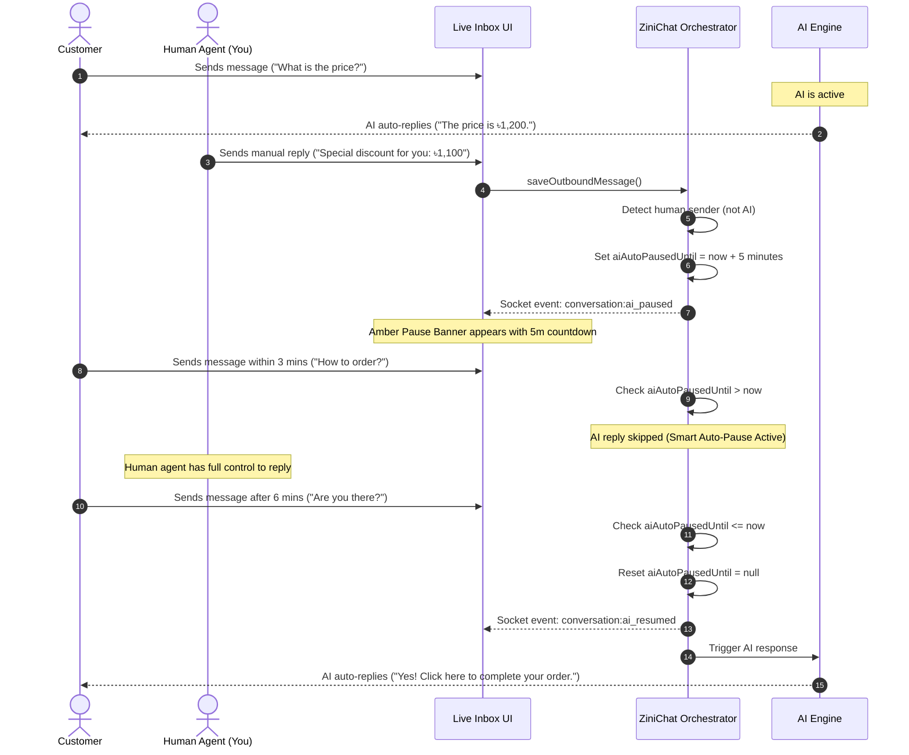

# Smart AI Auto-Pause on Human Intervention Manual (`হিউম্যান টেকওভার ও স্মার্ট AI অটো-পজ ম্যানুয়াল`)

## Overview
The **Smart AI Auto-Pause on Human Intervention** (`হিউম্যান রিপ্লাইয়ে স্মার্ট AI অটো-পজ`) feature allows live human agents to seamlessly intervene in customer conversations without conflicting with or being interrupted by the AI. When a human agent (tenant owner, admin, or support agent) replies to an inbox conversation, the AI assistant automatically pauses for a configurable duration (e.g., 5 minutes). If the human agent steps away or stops replying and the pause timer expires, the AI automatically wakes up and resumes answering incoming customer messages without requiring any manual clicks.

---

## 1. Core Feature Pillars

| Feature Pillar | Description | Key Merchant Benefit |
| :--- | :--- | :--- |
| 🛑 **Automatic AI Suppression on Human Reply** | Automatically detects when a human agent sends a message from the Inbox and pauses AI auto-replies for that chat. | Eliminates awkward duplicate or contradictory replies between human agents and AI. |
| ⏱️ **Configurable Pause Duration** | Choose your pause window: 1 min, 2 mins, 3 mins, 5 mins (Standard), 10 mins, 15 mins, or 30 mins in AI Training Settings. | Adapts to fast-paced retail or detailed consultative sales workflows. |
| ⚡ **Seamless Auto-Resume** | When a customer messages after the pause window expires, the AI automatically clears the pause state and answers immediately. | Zero missed leads—AI never stays permanently turned off by accident. |
| 🚀 **Instant 1-Click "Resume AI Now" Button** | Human agents can immediately unpause the AI at any time using the header or banner button (`⚡ Resume AI Now`). | Complete control when the human finishes helping earlier than the pause timer. |
| 📡 **Real-Time Cross-Agent Socket Sync** | Broadcasts `conversation:ai_paused` and `conversation:ai_resumed` across all connected agents in real time. | The entire team sees live countdown chips and pause indicators instantly. |
| 🛡️ **Zero AI Quota Cannibalization** | Manual agent messages and suppressed AI responses consume 0 AI Response Credits. | Completely protects your subscription AI quota pool from accidental deductions. |

---

## 2. How It Works (Step-by-Step Flow)

---

## 3. Configuring Smart Auto-Pause in AI Settings

1. Navigate to **Dashboard > Settings > AI Training** (`/dashboard/settings/ai-training`).
2. In **Section 1: AI Persona & Core Rules**, locate the **"Smart Human Takeover & AI Auto-Pause"** (`হিউম্যান টেকওভার ও স্মার্ট AI অটো-পজ`) section.
3. **Toggle Switch**:
   - Turn **ON** to enable automatic AI pause whenever an agent replies.
   - Turn **OFF** if you want AI to continue answering regardless of human messages.
4. **Select Pause Duration**:
   - Click any duration chip: `1m`, `2m`, `3m`, `5m (Standard)`, `10m`, `15m`, or `30m`.
   - Settings save automatically in real time with a confirmation toast.

---

## 4. Live Indicators in the Inbox

When Smart Auto-Pause is active on a conversation:
1. **Conversation List Chip**: A compact `⏸️ Paused` (`পজ`) badge appears on the chat card so agents can identify human-handled chats at a glance.
2. **Chat Header Badge**: An animated amber badge `⏸️ AI Paused (Xm)` appears right beside the customer name.
3. **Desktop Header CTA**: A quick **"Resume AI"** button allows you to re-enable AI in 1 click.
4. **Amber Notice Banner**: An amber glassmorphic banner appears right above the message thread:
   - Displays exact minutes remaining in the pause window.
   - Clarifies that AI will automatically resume once the timer expires.
   - Contains a prominent **"⚡ Resume AI Now"** (`এখনই AI চালু করুন`) button.

---

## 5. Frequently Asked Questions (FAQ)

### Q1: What happens if I want the AI to take over immediately?
Click the **"⚡ Resume AI Now"** button in either the top chat header or the amber notice banner. The pause window is immediately cleared in the database, and the AI will answer the customer's next message.

### Q2: Does a human agent's message consume AI response credits?
**No, absolutely not.** Per ZiniChat's Independent Quota Pool architecture, human messages count only towards your standard message quota. When AI is auto-paused, 0 AI response credits are deducted.

### Q3: What happens if a customer sends multiple messages while AI is paused?
All incoming messages are stored and displayed live in your chat feed for the human agent to read. AI auto-replies remain suppressed until either the human clicks "Resume AI Now" or the pause timer expires.

### Q4: Does the AI automatically wake up if the customer messages after 5 minutes?
**Yes.** Once the countdown expires (`now >= aiAutoPausedUntil`), the first incoming message from the customer automatically resets the pause state and generates a fresh AI reply based on your latest business Q&A and catalog.
